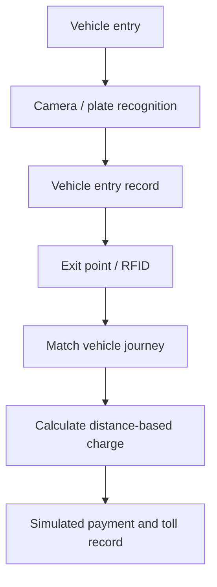

# Dynamic Toll Charging System

   

A university research prototype for distance-based toll collection. It combines automatic number plate recognition (ANPR), RFID-based vehicle identification, entry/exit tracking and simulated toll payments to explore an alternative to fixed-price toll booths.

## Engineering highlights

- Computer vision for vehicle and number plate recognition using YOLO and OCR.
- RFID-based identification and an exit-point API.
- Django data models for vehicles, cameras, exit points, entry events and toll records.
- Distance-based charging logic and a simulated payment workflow.
- Web-based management interface for monitoring and administration.

## System workflow



## Repository structure

| Path | Responsibility |
| --- | --- |
| `Core/` | Vehicle, entry, exit and toll models; core application workflows |
| `API/` | API endpoints for exit-point processing |
| `CoreApp/` | Django application configuration and URL routing |
| `Templates/` | Web interface templates |
| `Utils/` | Supporting utilities |
| `static/` | Frontend static assets |
| `requirements.txt` | Python dependencies |

## Local development

The project uses Django, Django REST Framework, OpenCV, OCR and ML tooling. Some vision dependencies are hardware- or platform-specific; review the pinned requirements before installation.

From the repository root:

```bash
python -m venv .venv
# Activate .venv using the command for your operating system.
python -m pip install -r requirements.txt
python manage.py migrate
python manage.py runserver
```

Configure test cameras, recognition model assets, exit points and RFID inputs for your local environment before running a complete vehicle journey. These are source-derived setup steps, not a verified deployment procedure.

## Publication

[Dynamic Toll Charging System — IJIRT (2026)](https://ijirt.org/article?manuscript=191077)

## Scope and limitations

The repository represents an academic research prototype. Payment and FASTag-style workflows are simulated; no live payment-network or highway integration is claimed. Real deployment would require validated recognition performance, secure secret management, privacy safeguards, production configuration, reliable hardware integration and regulatory review. Use synthetic or authorized test vehicle data.

For related engineering work and case studies, visit [andrewneil.dev](https://andrewneil.dev).
